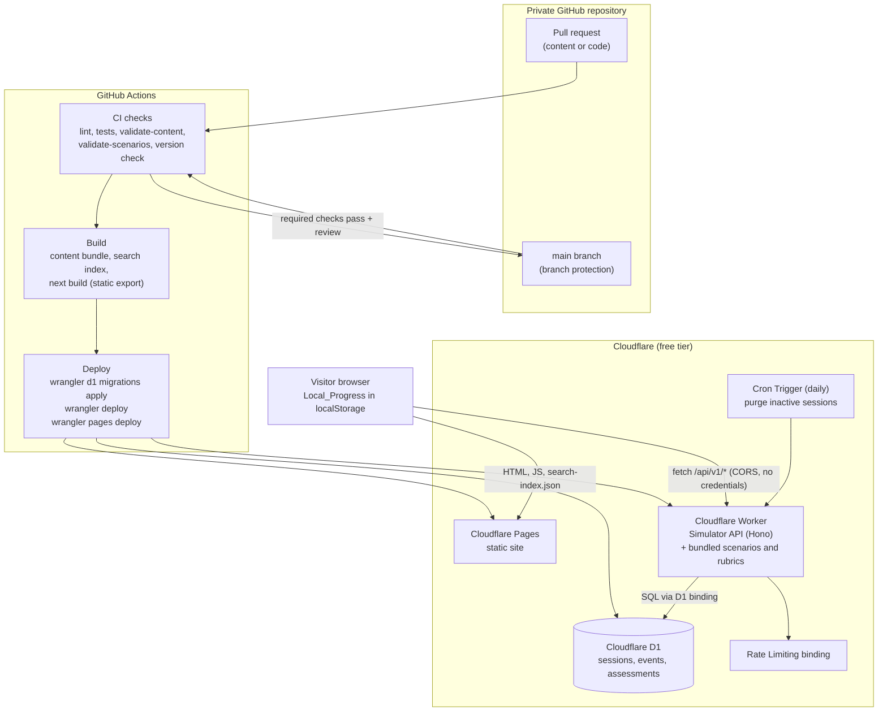
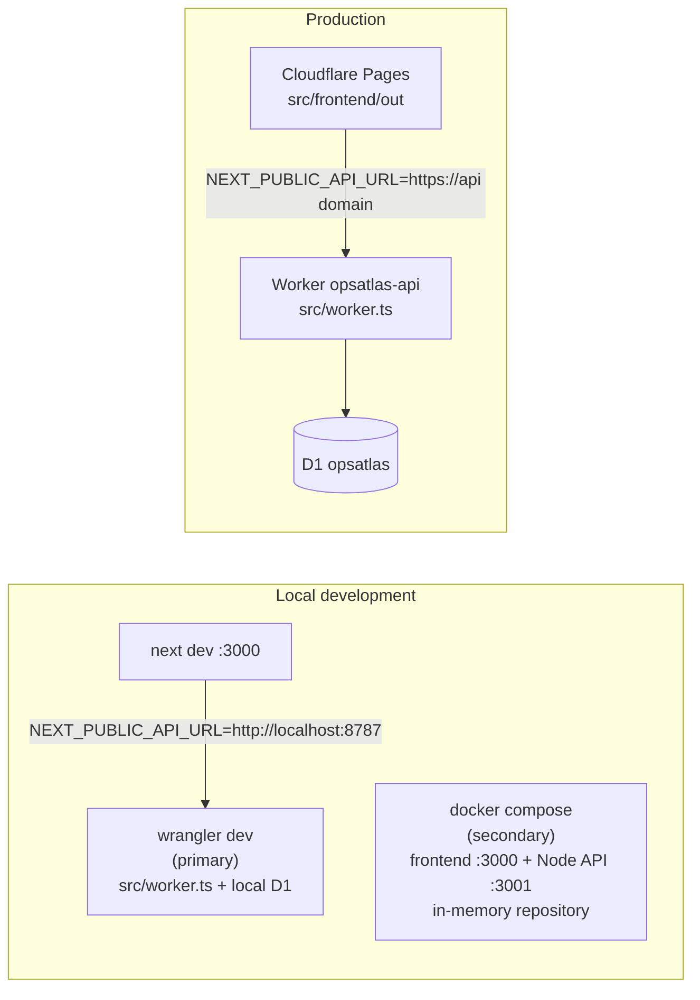
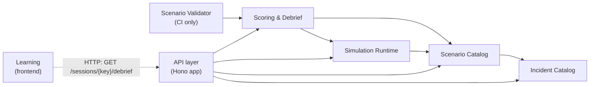
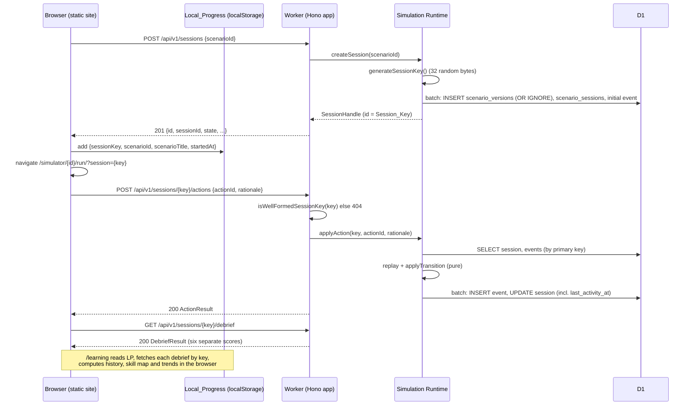

# Design Document

## Overview

OpsAtlas is a free, public operational learning platform with two surfaces: the **Incident Atlas**, a curated, source-cited knowledge base of real production failures, and the **Production Decision Simulator**, a deterministic branching exercise environment where engineers practise operational judgment.

The Platform has **no sign-in, no accounts and no user identity**. A Visitor starts an anonymous Session and receives a **Session_Key**, a 256-bit random value that is both the session id and the only access control. The Visitor's history lives in the browser as **Local_Progress**; the `/learning` page is computed entirely in the browser from Local_Progress and each Session's debrief.

The deployment runs on Cloudflare free tiers:

- **Static site**: a Next.js static export (`output: "export"`) served by **Cloudflare Pages**. Atlas pages, the scenario catalog and all simulator pages are static HTML plus client-side JavaScript.
- **Simulator API**: one **Cloudflare Worker** running the shared Hono app, backed by **Cloudflare D1** (SQLite) for sessions, events and assessments. Scenario definitions and Rubrics are bundled into the Worker at build time. A daily Cron Trigger deletes sessions inactive for 30 days.
- **Content**: all incident, scenario and Rubric content lives in a **private GitHub repository**. Content_Contributors change content through pull requests; GitHub Actions validates content on every pull request and deploys both the site and the Worker on merge to `main`.

The site uses a single light colour theme.

### Binding Design Decisions

These decisions were fixed for this revision. Concerns about specific decisions are listed in [Design Concerns](#design-concerns) rather than silently changed.

| # | Decision |
|---|---|
| D1 | No authentication anywhere. The managed identity provider, JWT middleware (`src/api/middleware/auth.ts` and its tests), roles, the Editor role, `/users` routes, `/admin` routes and the `/sign-in` page are removed. |
| D2 | The Session_Key is 32 bytes from `crypto.getRandomValues`, base64url-encoded without padding (43 characters, 256 bits). It is generated server-side and is the session id in API paths (`/api/v1/sessions/{sessionKey}/...`). Possession of the key is the only access control. Keys are never logged; logs carry at most an 8-hex-character SHA-256 prefix. Responses never include other sessions. Lookup is by primary key. Malformed keys are rejected with 404 `SESSION_NOT_FOUND` before any storage lookup. |
| D3 | Cloudflare D1 is the single persistent store in production. PostgreSQL is removed. D1 adapters implement the existing `SimulationRuntimeRepository` and the scoring `AssessmentRepository`. The schema is `db/migrations/0001_init.sql` with no `user_id` columns. `UNIQUE (session_id, sequence_pos)` stays. A daily Cron Trigger deletes sessions whose `last_activity_at` is older than 30 days. |
| D4 | `wrangler dev` with local D1 is the primary local run path and runs the same code as production. Docker Compose is reduced to the frontend dev server plus the Node API with the in-memory repository, with no database container. |
| D5 | Published scenario definitions and Rubrics are bundled into the Worker at build time from `content/` by a build script. No KV. Every published scenario version kept under `content/scenarios/` is in the bundle. Sessions also snapshot the scenario definition at creation via `saveScenarioVersion` (already implemented). |
| D6 | GitHub Actions builds and deploys with Wrangler (`wrangler pages deploy` and `wrangler deploy`), so CI gates every deploy. The Cloudflare Pages GitHub app integration is a documented alternative. Required secrets: `CLOUDFLARE_API_TOKEN`, `CLOUDFLARE_ACCOUNT_ID`. |
| D7 | The site calls the Worker at `NEXT_PUBLIC_API_URL`. The Worker sends CORS headers only for origins in `ALLOWED_ORIGINS` (the Pages production domain and `http://localhost:3000`). No cookies; no credentials mode. |
| D8 | Rate limit: 60 requests/min per client IP. Production uses the Workers Rate Limiting binding keyed by `CF-Connecting-IP`; local development uses the existing in-memory limiter. `/api/v1/health` is exempt. The authenticated tier is removed. |
| D9 | The learning page is computed client-side from Local_Progress (localStorage entries `{sessionKey, scenarioId, scenarioTitle, startedAt}`) plus each Session's debrief fetched by key. The skill-map and trend logic moves to a pure frontend module ported from `identity-learning`. The server-side `identity-learning` module and `/users` routes are removed. "Clear my progress" clears localStorage only. |
| D10 | The in-app content-governance service and admin routes are removed. The pure scenario validator (`validateScenarioDefinition`) is relocated to `src/modules/scenario-validator/` and used by the CI script `scripts/validate-scenarios.ts`. A CI script `scripts/check-scenario-versions.ts` fails when a published scenario version's content changes without a version bump. `scripts/validate-content.ts` (JSON Schema validation) stays. Branch protection settings are documented. |
| D11 | Light theme only: one palette in `globals.css` `@theme` meeting WCAG 2.2 AA (text ≥ 4.5:1, UI and focus ≥ 3:1), `color-scheme: light`, no dark colours. |
| D12 | One Hono app is shared by the local Node server and the Worker entry `src/worker.ts`. |

### Changes in This Revision

- Removed: identity provider, JWT auth, roles, `/users/*`, `/admin/*`, `/sign-in`, `/admin/content`, Content Governance service, Identity & Learning server module, PostgreSQL, KV, `user_skills` and `content_workflow_log` tables.
- Added: Session_Key design, Local_Progress, client-side learning module, D1 adapters and migration, Cron purge, Worker entry, bundled content, CORS allowlist, Rate Limiting binding, CI validation and version-bump scripts, GitHub Actions deployment, light palette.
- Correctness properties: numbering 1–11 is unchanged. Property 12 (Self-Approval Prevention) is retired because self-approval is now prevented by GitHub repository configuration, not application code; number 12 is reused for Session_Key format. Properties 13–16 are new.

---

## Architecture

### System Context



### Deployment Architecture



#### Local Development — `wrangler dev` (primary)

`wrangler dev` runs `src/worker.ts` in the local Workers runtime (workerd) with a local D1 database persisted under `.wrangler/state/`. This is the same code path as production: same app factory, same D1 adapters, same bundled content.

```bash
npm ci && npm --prefix src/frontend ci
npm run build:content-bundle                    # content/ -> src/generated/content-bundle.json
npx wrangler d1 migrations apply opsatlas --local
npx wrangler dev                                 # API on http://localhost:8787
# second terminal
NEXT_PUBLIC_API_URL=http://localhost:8787 npm run dev   # site on http://localhost:3000
```

Local `wrangler.toml` values for `ALLOWED_ORIGINS` include `http://localhost:3000`. The Rate Limiting binding is simulated locally by Wrangler; the Cron handler can be triggered with `npx wrangler dev --test-scheduled` and `curl "http://localhost:8787/__scheduled?cron=0+3+*+*+*"`.

#### Local Development — Docker Compose (secondary)

Docker Compose is kept for contributors who only want the site and a throwaway API. It has no database container. The API runs `src/server.ts` on Node with `InMemorySimulationRuntimeRepository` and in-memory assessments; data is lost on restart.

| Service | Image | Port | Notes |
|---|---|---|---|
| `api` | Node 20 Alpine (`Dockerfile.api`) | 3001 | `node dist/server.js`; in-memory repository; `ALLOWED_ORIGINS=http://localhost:3000` |
| `frontend` | Node 20 Alpine (`Dockerfile.frontend`) | 3000 | `next dev`; `NEXT_PUBLIC_API_URL=http://localhost:3001` |

```yaml
# docker-compose.yml (target)
services:
  api:
    build: { context: ., dockerfile: Dockerfile.api }
    ports: ['3001:3001']
    environment:
      NODE_ENV: development
      ALLOWED_ORIGINS: http://localhost:3000
    volumes:
      - ./src:/app/src:delegated
      - ./content:/app/content:ro
    command: sh -c "npx tsc --project tsconfig.json && node dist/server.js"

  frontend:
    build: { context: ., dockerfile: Dockerfile.frontend }
    ports: ['3000:3000']
    depends_on: [api]
    environment:
      NEXT_PUBLIC_API_URL: http://localhost:3001
      NODE_ENV: development
    volumes:
      - ./src/frontend:/app/src/frontend:delegated
      - /app/src/frontend/node_modules
      - /app/src/frontend/.next
      - ./content:/app/content:ro
    command: npm run dev
```

The `db` service, `postgres_data` volume, `DATABASE_URL`, `AUTH_ISSUER` and `AUTH_AUDIENCE` are removed. `db/schema.sql` (PostgreSQL) is deleted and replaced by `db/migrations/0001_init.sql`.

#### Production — Static Site (Cloudflare Pages)

- All routes are static HTML from `next build` with `output: "export"` and `trailingSlash: true` (already configured in `src/frontend/next.config.mjs`).
- Atlas content is read from `content/incidents/*.json` at build time (`src/frontend/lib/content.ts`, `featured.ts`, `linked-scenario.ts`). No runtime API calls are made for Atlas reads.
- Search runs in the browser against `search-index.json`, generated by `scripts/build-search-index.ts`.
- Simulator and learning pages are static shells with client components that call the Worker at `NEXT_PUBLIC_API_URL` (inlined at build time by `src/frontend/lib/api.ts`).
- `src/frontend/public/_headers` sets `Referrer-Policy: no-referrer` for all paths, because simulator URLs carry the Session_Key in the `?session=` query string (see [Design Concerns](#design-concerns)).

#### Production — Simulator API (Cloudflare Worker)

- `src/worker.ts` exports `fetch` (the shared Hono app) and `scheduled` (the purge job).
- Bindings in `wrangler.toml`:

```toml
name = "opsatlas-api"
main = "src/worker.ts"
compatibility_date = "2025-01-01"

[vars]
ALLOWED_ORIGINS = "https://opsatlas.pages.dev"   # production Pages domain; localhost:3000 added in [env.dev]

[[d1_databases]]
binding = "DB"
database_name = "opsatlas"
database_id = "<set after `wrangler d1 create opsatlas`>"
migrations_dir = "db/migrations"

[[ratelimits]]
name = "RATE_LIMITER"
namespace_id = "1001"
simple = { limit = 60, period = 60 }

[triggers]
crons = ["0 3 * * *"]                              # daily 03:00 UTC

[observability]
enabled = false                                    # request URLs contain Session_Keys
```

- Scenario definitions and Rubrics are imported from `src/generated/content-bundle.json`, produced by `scripts/build-content-bundle.ts`. Wrangler's esbuild bundles the JSON import into the Worker script.

#### Build and Deploy Pipeline (GitHub Actions)

Two workflows live in `.github/workflows/`.

`ci.yml` runs on `pull_request` to `main` and on `push` to `main`:

1. `npm ci` (root and `src/frontend`)
2. `npm run lint` and `tsc --noEmit`
3. `npm run test:run` (root) and frontend `vitest run`
4. `npm run validate-content` (AJV JSON Schema validation of incidents and scenarios)
5. `npm run validate-scenarios` (graph validator, Requirement 13)
6. `npm run check-scenario-versions -- --base <sha>` where `<sha>` is `github.event.pull_request.base.sha` on pull requests and `github.event.before` on pushes
7. `npm run build:content-bundle`, `npm run build:search-index`, `next build`
8. `npx wrangler deploy --dry-run --outdir dist-worker` (proves the Worker bundles without Node-only imports)

`deploy.yml` runs on `push` to `main` only, with `concurrency: { group: deploy-production, cancel-in-progress: false }` and the GitHub environment `production`. Its single job `needs` the CI jobs (implemented as a reusable `workflow_call` of `ci.yml`) and then runs:

1. `npx wrangler d1 migrations apply opsatlas --remote`
2. `npx wrangler deploy` (API first, so the new site never calls an older API)
3. `npx wrangler pages deploy src/frontend/out --project-name opsatlas --branch main`

Secrets and variables:

| Name | Kind | Used by | Notes |
|---|---|---|---|
| `CLOUDFLARE_API_TOKEN` | Actions secret | `deploy.yml` | Scoped token: Workers Scripts Edit, D1 Edit, Cloudflare Pages Edit, Account Settings Read |
| `CLOUDFLARE_ACCOUNT_ID` | Actions secret | `deploy.yml` | Account that owns the Worker, D1 and Pages project |
| `NEXT_PUBLIC_API_URL` | Actions variable | `next build` | Public Worker URL; not secret |

Migrations must be backward compatible with the currently deployed Worker (additive columns and tables only), because step 1 runs before step 2.

**Alternative: Cloudflare Pages GitHub app integration.** Pages can be connected directly to the private repository so Cloudflare builds the site on every push. This removes `wrangler pages deploy` from `deploy.yml` but has two costs: Pages builds run regardless of GitHub Actions results, so CI no longer gates site deploys, and Pages creates public preview deployments (`*.opsatlas.pages.dev`) for every branch, which would publish unmerged content. If chosen, disable preview deployments (or protect them with Cloudflare Access) and keep the Worker deploy in GitHub Actions.

#### Free-Tier Limits

| Resource | Free limit | Design impact |
|---|---|---|
| Workers requests | 100,000 per day per account | Static Atlas reads never hit the Worker. OPTIONS preflights count. |
| Workers CPU | 10 ms per invocation | Session reads replay the event log; MVP scenarios have tens of events, well within budget. |
| D1 storage | 5 GB per account, 500 MB per database | 30-day purge bounds growth. |
| D1 rows read / written | 5 million read, 100,000 written per day | Reads by primary key and `(session_id, sequence_pos)`; GET requests never write. |
| Cron Triggers | 5 per account | One trigger used. |
| Rate Limiting binding | Available on Free; counts are per Cloudflare location and approximate | See [Design Concerns](#design-concerns). |
| GitHub Actions (private repo, Free plan) | 2,000 minutes per month | One CI run per push; deploy only on `main`. |

Sources: [Workers limits](https://developers.cloudflare.com/workers/platform/limits/), [D1 limits](https://developers.cloudflare.com/d1/platform/limits), [D1 pricing](https://developers.cloudflare.com/d1/platform/pricing/), [Rate Limiting binding](https://developers.cloudflare.com/workers/runtime-apis/bindings/rate-limit/). Limits change; re-check before launch.

### Module List and Dependency Graph

| Module | Location | Runs in | Responsibility |
|---|---|---|---|
| Incident Catalog | `src/modules/incident-catalog/` | Build time (site), Node API, Worker (bundled) | Incident records, search and filter |
| Scenario Catalog | `src/modules/scenario-catalog/` | Build time, Node API, Worker (bundled) | Published scenario versions, catalog entries, briefs |
| Simulation Runtime | `src/modules/simulation-runtime/` | Node API, Worker | Pure engine, session lifecycle, Session_Key, event log, repository port, in-memory and D1 adapters, purge |
| Scoring & Debrief | `src/modules/scoring-debrief/` | Node API, Worker | Rubric versions, six-dimension scoring, debrief, replay, assessment adapters |
| Scenario Validator | `src/modules/scenario-validator/` | CI only | Pure graph validation (relocated from `content-governance/validator.ts`) |
| Learning (frontend) | `src/frontend/lib/learning.ts`, `local-progress.ts` | Browser | Local_Progress storage, history, skill map, trends |
| Analytics | not implemented in MVP code | — | Aggregated, key-free usage counts (deferred; must never record Session_Keys) |

Removed modules: `content-governance` (service, scenarios repository, self-approval tests) and `identity-learning`.



`SV --> SD` is a type-only dependency on `RubricDefinition["terminalStates"]`. Each module is imported only through `modules/{name}/index.ts`. No server module depends on Learning; the browser talks to the API only over HTTP.

### Content Layout and Versioning

```
content/
  incidents/{slug}.json               # one file per published incident
  scenarios/{id}@{version}.json       # one file per published scenario version
  rubrics/{version}.json              # one file per Rubric version
  schema/
    incident.schema.json
    scenario.schema.json
    rubric.schema.json
```

- A scenario version is **published** when its file exists on `main`. Draft content exists only on branches and unmerged pull requests, which are never deployed (Req 12.1).
- Files are immutable once merged. A content change to a published scenario requires a new file with a new `version` (Req 12.8). Old version files are never deleted, so every pinned version stays replayable from the bundle (Req 6.4, 12.9). The session snapshot in `scenario_versions` is a second copy.
- The catalog lists the highest version (semver order) of each scenario id. Older versions are reachable only by `(id, version)` lookups for pinned sessions and retries.
- Existing files (`example-fixture.json`) are renamed to the `{id}@{version}.json` convention as part of the migration. The loader keys versions by the `id` and `version` fields inside the file, not by file name, and fails the bundle build on duplicate `(id, version)` pairs.
- Rubrics: the default rubric now lives in code (`createDefaultRubric()`, version `1.0.0`). It moves to `content/rubrics/1.0.0.json` so Rubrics follow the same PR workflow and versioning (Req 19.3).

`scripts/build-content-bundle.ts` reads `content/scenarios/*.json` and `content/rubrics/*.json`, validates them with the same guards the catalog uses, and writes:

```typescript
// src/generated/content-bundle.json (generated, git-ignored)
interface ContentBundle {
  generatedAt: string;
  scenarios: ScenarioContentFile[];   // every published version
  rubrics: RubricDefinition[];        // every Rubric version
  incidents: IncidentContentFile[];   // only if the Worker keeps /incidents routes
}
```

### Branch Protection (repository configuration)

Configured on `main` of the private repository as a branch protection rule or ruleset:

- Require a pull request before merging; require 1 approving review; dismiss stale approvals on new commits; require review from someone other than the last pusher.
- Require status checks to pass: the `ci.yml` jobs (lint, test, validate-content, validate-scenarios, check-scenario-versions, build). Require branches to be up to date.
- Block force pushes and deletions; do not allow bypass (include administrators).

GitHub never counts a pull request author's own approval, which replaces the old self-approval code path (former Property 12). Protected branches on **private** repositories require GitHub Pro, Team or Enterprise (see [Design Concerns](#design-concerns)).

### Request Flow — Anonymous Simulator Session



---

## Components and Interfaces

### Frontend Route Components

All routes are statically exported and served by Cloudflare Pages. "Client" means the page shell is static and a client component calls the Worker.

| Route | Component | Rendering | Data source |
|---|---|---|---|
| `/` | `HomeView` | Static | Build-time content (`featured.ts`) |
| `/atlas` | `AtlasBrowser` | Static + client-side filter | Build-time content + `search-index.json` |
| `/atlas/incidents/{slug}` | `IncidentDetail` | Static (`generateStaticParams`) | Build-time content |
| `/simulator` | `ScenarioCatalog` | Static | Build-time content (`lib/scenarios.ts`) |
| `/simulator/{id}/brief` | `BriefClient` | Static shell (`generateStaticParams` from `scenarioIds.ts`) + client | `GET /scenarios/{id}/brief`, `POST /sessions` |
| `/simulator/{id}/run/?session={key}` | `RunClient` | Static shell + client | `/sessions/{key}`, `/options`, `/actions`, `/evidence`, `/pause`, `/resume`, `/abandon` |
| `/simulator/{id}/debrief/?session={key}` | `DebriefClient` | Static shell + client | `/sessions/{key}/debrief`, `/debrief/steps/{n}`, retry via `POST /sessions` |
| `/learning` | `LearningView` | Static shell + client | Local_Progress + `/sessions/{key}/debrief`; scenario skill tags embedded at build time |

Removed routes: `/sign-in` (`app/sign-in/page.tsx`) and `/admin/content` (`app/admin/content/*`). Removed client libraries: `lib/auth.ts`, `lib/admin-client.ts`; `lib/learning-client.ts` is replaced by `lib/learning.ts` and `lib/local-progress.ts`. `lib/session-client.ts` drops the `token` parameter and the `Authorization` header from every call.

### Backend API Surface

All routes are prefixed `/api/v1`, served by the same Hono app on Node and on the Worker. There is no authentication. `{key}` is a Session_Key.

| Method | Path | Module | Notes |
|---|---|---|---|
| GET | `/health` | API | Exempt from rate limiting |
| GET | `/incidents` | Incident Catalog | Query `q` (≤ 200 chars), `provider`, `technology`, `failure_domain`, `severity` |
| GET | `/incidents/{slug}` | Incident Catalog | 404 `INCIDENT_NOT_FOUND` |
| GET | `/scenarios` | Scenario Catalog | Latest published version per id |
| GET | `/scenarios/{id}/brief` | Scenario Catalog | 404 `SCENARIO_VERSION_NOT_FOUND` |
| POST | `/sessions` | Simulation Runtime | Body `{scenarioId, scenarioVersion?}`; 201 with the new Session_Key in `id` and `sessionId` |
| GET | `/sessions/{key}` | Simulation Runtime | Session record, reconstructed state, pending events, events |
| GET | `/sessions/{key}/options` | Simulation Runtime | Actions (with unmet preconditions and modified attributes) and evidence for the current state |
| GET | `/sessions/{key}/journal` | Simulation Runtime | Read-only Decision_Journal (action and evidence_request entries) |
| POST | `/sessions/{key}/actions` | Simulation Runtime | Body `{actionId, rationale}` |
| POST | `/sessions/{key}/evidence` | Simulation Runtime | Body `{evidenceId}` |
| POST | `/sessions/{key}/pause` | Simulation Runtime | |
| POST | `/sessions/{key}/resume` | Simulation Runtime | |
| POST | `/sessions/{key}/abandon` | Simulation Runtime | |
| GET | `/sessions/{key}/debrief` | Scoring & Debrief | 409 `SESSION_NOT_CONCLUDED` while active or paused |
| GET | `/sessions/{key}/debrief/steps/{step}` | Scoring & Debrief | `step` is a non-negative integer |
| PATCH, PUT, DELETE (and edit-like POST) | `/sessions/{key}/{actions,evidence,events,journal}/...` | Journal immutability guard | 403 `JOURNAL_IMMUTABLE` when concluded, 405 otherwise |

There is no endpoint that lists sessions. Removed: `/users/me/learning`, `/users/me/skills`, all `/admin/*`.

`scenarioVersion` on `POST /sessions` is optional. When present, the runtime pins that exact version from the bundle and returns 404 `SCENARIO_VERSION_NOT_FOUND` if it does not exist (Req 6.6). The debrief retry button sends the pinned version so the retry uses the same scenario version (Req 10.7). The current runtime only supports the latest version; this parameter is a required change (see concerns).

### API Application Wiring

`src/server.ts` currently builds a module-level `app` wired to in-memory defaults and imports `@hono/node-server`. The Worker cannot import it. The target split is:

```typescript
// src/app.ts — shared, runtime-neutral (no node:* imports)
export interface AppDeps {
  sessions: SimulationRuntimeServiceContract;
  scoring: ScoringServiceContract;
  scenarios: ScenarioCatalogService;
  incidents: IncidentCatalogService;
  rateLimit: MiddlewareHandler;
  allowedOrigins: readonly string[];
}

export function createApp(deps: AppDeps): Hono {
  const app = new Hono();
  app.use("*", requestIdMiddleware);
  app.use("*", corsAllowlist(deps.allowedOrigins)); // answers OPTIONS preflight
  app.use("*", deps.rateLimit);                     // health exempt
  app.get("/api/v1/health", healthHandler);
  app.route("/api/v1/incidents", createIncidentCatalogRoutes(deps.incidents));
  app.route("/api/v1/scenarios", createScenarioCatalogRoutes(deps.scenarios));
  app.route("/api/v1/sessions", createSessionRoutes(deps.sessions));
  app.route("/api/v1/sessions", createDebriefRoutes(deps.scoring));
  app.onError(redactingErrorHandler);
  return app;
}
```

```typescript
// src/server.ts — Node entry (local and Docker Compose)
const app = createApp({
  ...inMemoryDeps(),                 // InMemory repositories, File* catalogs
  rateLimit: createRateLimitMiddleware({ resolveIp: nodeSocketIp }),
  allowedOrigins: parseOrigins(process.env["ALLOWED_ORIGINS"] ?? "http://localhost:3000"),
});
serve({ fetch: app.fetch, port: 3001 });
```

```typescript
// src/worker.ts — Cloudflare Worker entry
export interface Env {
  DB: D1Database;
  RATE_LIMITER: RateLimit;
  ALLOWED_ORIGINS: string;
}

let cached: { db: D1Database; app: Hono } | undefined;

function appFor(env: Env): Hono {
  if (cached?.db !== env.DB) {
    cached = { db: env.DB, app: createApp(workerDeps(env)) }; // D1 + bundled catalogs
  }
  return cached.app;
}

export default {
  fetch: (req: Request, env: Env, ctx: ExecutionContext) => appFor(env).fetch(req, env, ctx),
  scheduled: (event: ScheduledController, env: Env, ctx: ExecutionContext) => {
    ctx.waitUntil(purgeInactiveSessions(env.DB, new Date(event.scheduledTime)));
  },
} satisfies ExportedHandler<Env>;
```

Node-only code (`node:fs` catalogs, `@hono/node-server/conninfo`, `node:crypto`) must stay out of `src/app.ts` and everything it imports for the Worker. `FileScenarioRepository` and the file-backed incident repository are used by `server.ts` and build scripts only; the Worker uses `BundledScenarioRepository`, `BundledRubricRepository` and `BundledIncidentRepository` over `content-bundle.json`.

### Session_Key

```typescript
// src/modules/simulation-runtime/session-key.ts (runtime-neutral)
export const SESSION_KEY_BYTES = 32;
export const SESSION_KEY_PATTERN = /^[A-Za-z0-9_-]{43}$/;

/** 32 bytes from the platform CSPRNG, base64url without padding (43 chars, 256 bits). */
export function generateSessionKey(): string {
  const bytes = new Uint8Array(SESSION_KEY_BYTES);
  crypto.getRandomValues(bytes);
  return base64UrlEncode(bytes);
}

/** Format check only; never touches storage. */
export function isWellFormedSessionKey(value: string): boolean {
  return SESSION_KEY_PATTERN.test(value) && base64UrlDecode(value).length === SESSION_KEY_BYTES;
}

/** First 8 hex chars of SHA-256(key), for logs only. */
export async function sessionKeyFingerprint(key: string): Promise<string> {
  const digest = await crypto.subtle.digest("SHA-256", new TextEncoder().encode(key));
  return [...new Uint8Array(digest)].slice(0, 4).map((b) => b.toString(16).padStart(2, "0")).join("");
}
```

Rules:

- Generation is server-side only. `SimulationRuntimeOptions` gains `sessionKeyGenerator?: () => string` (default `generateSessionKey`), separate from `idGenerator`, which keeps producing UUIDs for event and assessment ids. Today the session id comes from `idGenerator` (`crypto.randomUUID()`, 122 random bits), which is below the 128-bit requirement.
- A `sessionKeyParam` middleware on `/:key/*` in both session and debrief routes returns 404 `SESSION_NOT_FOUND` for malformed keys before the service is called. The runtime does not trust this and returns 404 for any unknown key.
- Lookup is `SELECT ... WHERE id = ?` on the primary key. Timing differences between "malformed" and "well-formed but unknown" reveal nothing useful, because the key space is 2^256.
- Unknown keys and keys of deleted (purged) sessions are indistinguishable: both return 404 `SESSION_NOT_FOUND`.
- Logging: application code never logs a key, a request path that contains a key, or an error message that embeds a key. The global `onError` handler logs only the error name, request id and, when a key is in scope, `sessionKeyFingerprint(key)`. `assertSequenceFree` in the runtime currently embeds `event.sessionId` in its error message, and `server.ts`'s `onError` logs the whole error object; both must be changed.
- Responses only ever describe the session addressed by the key in the path.

### CORS

```typescript
// src/api/middleware/cors.ts
export function corsAllowlist(allowed: readonly string[]): MiddlewareHandler {
  return cors({
    origin: (origin) => (allowed.includes(origin) ? origin : null),
    allowMethods: ["GET", "POST", "OPTIONS"],
    allowHeaders: ["Content-Type"],
    exposeHeaders: ["Retry-After", "X-Request-Id"],
    credentials: false,
    maxAge: 600,
  });
}
```

`ALLOWED_ORIGINS` is a comma-separated list parsed once per isolate. Requests from other origins receive no `Access-Control-Allow-Origin` header, so browsers block the response. CORS is a browser policy, not access control; the Session_Key remains the only access control. The site sends no cookies and never sets `credentials: "include"`.

### Rate Limiting

```typescript
// src/api/middleware/rateLimit.ts (target shape)
export const WINDOW_MS = 60_000;
export const IP_LIMIT = 60;
export const HEALTH_PATH = "/api/v1/health";

export interface RateLimiter {
  /** true when the request is allowed. */
  allow(key: string): Promise<{ allowed: boolean; retryAfterSeconds: number }>;
}

// Production: Workers Rate Limiting binding
export function bindingLimiter(binding: RateLimit): RateLimiter {
  return {
    async allow(key) {
      const { success } = await binding.limit({ key });
      return { allowed: success, retryAfterSeconds: success ? 0 : 60 };
    },
  };
}

// Local: existing InMemoryRateLimitStore sliding log with limit 60 / 60 s
export function inMemoryLimiter(store = new InMemoryRateLimitStore()): RateLimiter;

export function createRateLimitMiddleware(opts: {
  limiter: RateLimiter;
  resolveIp: (c: Context) => string;
}): MiddlewareHandler;
```

- Key: `ip:{CF-Connecting-IP}` on the Worker (set by Cloudflare and not client-controlled there); the Node server uses the socket address, and `TRUST_PROXY_HEADERS` stays available for local proxies.
- Exempt: `/api/v1/health`. CORS preflights are answered by the CORS middleware before the limiter.
- Rejection: 429 `RATE_LIMIT_EXCEEDED` with `Retry-After` and `details.retry_after_seconds` (Req 17.4). The in-memory limiter computes the exact remaining window; the binding does not report a reset time, so the Worker returns the window length (60 s) as an upper bound.
- Removed: the token bucket, the `UNAUTHENTICATED_LIMIT` of 20 and `AUTHENTICATED_LIMIT` of 100, and the `node:crypto` import. `@hono/node-server/conninfo` moves into the Node IP resolver used by `server.ts`.

### Module Public Interfaces (TypeScript)

```typescript
// Incident Catalog (unchanged)
interface IncidentCatalogService {
  listPublished(filters: IncidentFilters): Promise<IncidentSummary[]>;
  getBySlug(slug: string): Promise<IncidentDetail | null>;
  search(query: string, filters: IncidentFilters): Promise<IncidentSummary[]>;
}

// Scenario Catalog
interface ScenarioRepository {
  listPublished(): Promise<ScenarioContentFile[]>;              // latest version per id
  getById(id: string): Promise<ScenarioContentFile | null>;     // latest version
  getVersion(id: string, version: string): Promise<ScenarioContentFile | null>; // new
}
interface ScenarioCatalogService {
  listPublished(): Promise<ScenarioSummary[]>;
  getScenarioBrief(id: string): Promise<ScenarioBrief | null>;
}

// Simulation Runtime (userId removed everywhere)
interface SimulationRuntimeServiceContract {
  createSession(scenarioId: string, scenarioVersion?: string): Promise<SessionHandle>;
  getSession(sessionKey: string): Promise<SessionState>;
  getSessionOptions(sessionKey: string): Promise<SessionOptions>;
  applyAction(sessionKey: string, actionId: string, rationale: string): Promise<ActionResult>;
  requestEvidence(sessionKey: string, evidenceId: string): Promise<EvidenceResult>;
  pauseSession(sessionKey: string): Promise<SessionState>;
  resumeSession(sessionKey: string): Promise<SessionState>;
  abandonSession(sessionKey: string): Promise<SessionState>;
}

// Storage port (unchanged method set; SessionRecord loses userId)
interface SimulationRuntimeRepository {
  saveScenarioVersion(scenario: ScenarioContentFile): Promise<void>;
  getScenarioVersion(scenarioId: string, version: string): Promise<ScenarioContentFile | null>;
  createSession(session: SessionRecord, initialEvent: SessionEvent): Promise<void>;
  getSession(sessionId: string): Promise<SessionRecord | null>;
  listEvents(sessionId: string): Promise<SessionEvent[]>;
  appendEvent(event: SessionEvent): Promise<void>;
  updateSession(session: SessionRecord): Promise<void>;
  appendEventAndUpdateSession(event: SessionEvent, session: SessionRecord): Promise<void>;
}

// Purge (runtime-neutral, D1 implementation in d1-repository.ts)
function purgeInactiveSessions(db: D1Database, now: Date, maxAgeDays?: number): Promise<{ deleted: number }>;

// Scoring & Debrief (userId removed)
interface ScoringServiceContract {
  computeDebrief(sessionKey: string): Promise<DebriefResult>;
  getReplayStep(sessionKey: string, step: number): Promise<ReplayStep>;
}
interface AssessmentRepository {
  getBySessionId(sessionId: string): Promise<AssessmentRecord | null>;
  saveIfAbsent(record: AssessmentRecord): Promise<AssessmentRecord>;
}
interface RubricRepository {
  getByVersion(version: string): Promise<RubricDefinition | null>;
  // save() is removed: rubrics are read-only bundle content
}

// Scenario Validator (CI only; pure)
function validateScenarioDefinition(
  definition: ScenarioDefinition,
  rubric: Pick<RubricDefinition, "terminalStates">,
  options?: { timeTrigger?: string },
): ValidationResult; // { valid, violations: { stateOrActionId, category, description }[] }
```

`DebriefResult` gains `endedAt: string` (the session's `ended_at`) so the learning page can show the completion date without a second request.

### D1 Adapters

`D1SimulationRuntimeRepository` (`src/modules/simulation-runtime/d1-repository.ts`) and `D1AssessmentRepository` (`src/modules/scoring-debrief/d1-assessment-repository.ts`) take a `D1Database` in their constructor.

| Port method | D1 statements |
|---|---|
| `saveScenarioVersion` | `INSERT OR IGNORE INTO scenario_versions ...` (first write wins; immutable) |
| `getScenarioVersion` | `SELECT definition_json ... WHERE scenario_id = ? AND version = ?` |
| `createSession` | `db.batch([INSERT scenario_sessions, INSERT session_events])` with `last_activity_at = started_at` |
| `getSession` | `SELECT ... FROM scenario_sessions WHERE id = ?` |
| `listEvents` | `SELECT ... FROM session_events WHERE session_id = ? ORDER BY sequence_pos` |
| `appendEvent` | `db.batch([INSERT session_events, UPDATE scenario_sessions SET last_activity_at = ?])` |
| `updateSession` | `UPDATE scenario_sessions SET status, paused_at, ended_at, sim_time_elapsed, last_activity_at WHERE id = ?` |
| `appendEventAndUpdateSession` | `db.batch([INSERT session_events, UPDATE scenario_sessions ...])` |
| `AssessmentRepository.saveIfAbsent` | `INSERT ... ON CONFLICT(session_id) DO NOTHING`, then `SELECT` the stored row |

- D1 has no interactive transactions; `db.batch()` executes its statements atomically, which gives the same "event and session row together or not at all" guarantee as the in-memory adapter.
- All statements use bound parameters (`prepare(...).bind(...)`); no string interpolation.
- JSON columns are `TEXT` written with `JSON.stringify` and read with `JSON.parse`; values are cloned at the boundary by construction.
- Timestamps are ISO 8601 UTC strings from `Date.prototype.toISOString()`, so lexical comparison equals chronological comparison.
- `last_activity_at` is maintained by the adapter on every write. The domain `SessionRecord` does not change. GET requests never write, so viewing a debrief does not extend retention.
- A `UNIQUE (session_id, sequence_pos)` violation (two concurrent appends computed the same position) is mapped to `SimulationRuntimeError` 409 `SESSION_CONFLICT`; the client reloads the session and retries. The in-memory adapter's `assertSequenceFree` raises the same error.

### Purge Job

`purgeInactiveSessions(db, now, 30)` runs from the Worker `scheduled` handler:

```sql
-- cutoff = now - 30 days, ISO 8601
DELETE FROM scenario_sessions
WHERE id IN (SELECT id FROM scenario_sessions WHERE last_activity_at < ?1 LIMIT 500);
-- session_events and assessments are removed by ON DELETE CASCADE
DELETE FROM scenario_versions
WHERE NOT EXISTS (
  SELECT 1 FROM scenario_sessions s
  WHERE s.scenario_id = scenario_versions.scenario_id AND s.scenario_version = scenario_versions.version
);
```

The first statement repeats until it deletes fewer than 500 rows or a per-run cap is reached, keeping each run within free-tier write limits. The job logs only counts. Snapshot rows for purged sessions are removed; pinned versions remain replayable from the bundle.

### Local_Progress (frontend)

```typescript
// src/frontend/lib/local-progress.ts
export const LOCAL_PROGRESS_KEY = "opsatlas.localProgress.v1";
export const MAX_ENTRIES = 200;

export interface LocalProgressEntry {
  sessionKey: string;      // 43-char base64url
  scenarioId: string;
  scenarioTitle: string;
  startedAt: string;       // ISO 8601
}

export interface ProgressStore {             // window.localStorage in the browser, Map in tests
  getItem(key: string): string | null;
  setItem(key: string, value: string): void;
  removeItem(key: string): void;
}

export function readProgress(store: ProgressStore): LocalProgressEntry[];
export function addProgress(store: ProgressStore, entry: LocalProgressEntry): LocalProgressEntry[];
export function clearProgress(store: ProgressStore): void;
```

- Stored value: `{"version":1,"entries":[...]}`. `readProgress` returns `[]` for missing, unparsable or wrong-version data and drops entries that fail the shape check or the Session_Key format check.
- `addProgress` is idempotent per `sessionKey`, keeps entries newest first by `startedAt`, and trims to `MAX_ENTRIES`.
- If `localStorage` throws (disabled storage, private mode quota), the store falls back to an in-memory map for the tab and `/learning` shows a notice that progress cannot be saved.
- Local_Progress is never sent to the API. Only the individual key appears in the path of the request that needs it (Req 18.7).
- `BriefClient` calls `addProgress` right after `POST /sessions` returns 201 (Req 9.5). `DebriefClient`'s retry does the same for the new session.

### Learning Calculations (frontend)

`src/frontend/lib/learning.ts` is a pure port of `IdentityAndLearningService` that takes the data instead of reading a user-scoped repository.

```typescript
export type DebriefLookup =
  | { status: "ok"; debrief: DebriefResult }
  | { status: "unavailable" };            // 404, purged, or network error after retry

export interface LearningInput {
  entry: LocalProgressEntry;
  result: DebriefLookup;
  skillTags: string[];                    // from the build-time scenario catalog, by scenarioId
}

export interface LearningView {
  history: HistoryEntry[];                // newest first; unavailable entries flagged
  skillMap: SkillMapEntry[];              // empty when no completed sessions
  scenarioTrends: ScenarioTrend[];        // only scenarios with >= 2 completed attempts show trends
}

export function computeLearningView(inputs: readonly LearningInput[]): LearningView;
```

Rules carried over from the server module:

- A session counts as completed when its debrief `sessionStatus` is `completed` or `timed_out`. Abandoned sessions appear in history but do not feed the skill map or trends.
- History is ordered newest first by `startedAt`, ties broken by `sessionKey`. `completionDate` is `endedAt` formatted `YYYY-MM-DD` in UTC. Each entry carries the six dimension scores separately.
- Proficiency per Skill_Tag: `clamp(1 + 4 × M / maxScore, 1, 5)` rounded to one decimal, where `M` is the mean of the six dimension scores averaged over completed sessions whose scenario carries that tag. `maxScore` comes from each debrief (the default rubric uses 10; the server module defaulted to 100).
- Evidence count per Skill_Tag: number of completed sessions carrying the tag.
- Scenario trend per Score_Dimension: compare the most recent completed session with the immediately preceding completed session of the same scenario at two-decimal precision: `up`, `down` or `unchanged`.
- Sessions marked `unavailable` are excluded from the skill map and trends and shown in history as "no longer available" (Req 11.10).

`LearningView` (the component) reads Local_Progress, fetches debriefs with bounded concurrency (4 at a time), calls `computeLearningView`, and renders. "Clear my progress" calls `clearProgress` and shows the empty state; it makes no API call and does not delete server data, which expires through the 30-day purge.

### Scenario Engine (unchanged)

The scenario engine is a pure deterministic state machine. It takes a `(state, action)` pair and produces a `(next_state, effects)` pair with no I/O. Randomness is forbidden; all outcomes come from the scenario definition JSON.

```typescript
// Core engine function — pure, no I/O
function applyTransition(
  state: ScenarioState,
  action: ScenarioAction,
  definition: ScenarioDefinition
): TransitionResult {
  // 1. Evaluate preconditions against current state
  // 2. Find matching Transition from definition
  // 3. Apply effects to produce next state
  // 4. Schedule any delayed_effects as pending events
  // 5. Return { nextState, sideEffects, pendingEvents, simTimeDelta }
}
```

Sessions are append-only event logs. The current state is always reconstructible by replaying the event log through `applyTransition` from the initial state of the pinned scenario version.

### CI Scripts

| Script | npm script | Behaviour |
|---|---|---|
| `scripts/validate-content.ts` | `validate-content` | Unchanged. AJV validation of incidents and scenarios; extended to `content/rubrics/` with `rubric.schema.json`. Enforces at least one source with a `source_tier` (Req 3.2, 12.7). |
| `scripts/validate-scenarios.ts` | `validate-scenarios` | Loads every scenario file and its Rubric by `rubric_version`, runs `validateScenarioDefinition`, prints a structured violation list (`{file, stateOrActionId, category, description}`) and exits 1 on any violation, 2 on a system error (missing rubric file, unreadable JSON, thrown exception), 0 otherwise (Req 13.1–13.8). |
| `scripts/check-scenario-versions.ts` | `check-scenario-versions` | Compares scenario files at `--base <sha>` (via `git show <sha>:<path>`) with the working tree. Builds maps keyed by `(id, version)`. Fails when a key present at base has different canonical JSON at head (content changed without a version bump) or is missing at head (a published version was deleted). New keys pass. Exits 1 with one message per offending file (Req 12.8, 12.9). |
| `scripts/build-content-bundle.ts` | `build:content-bundle` | Writes `src/generated/content-bundle.json`; fails on duplicate `(id, version)` or unknown `rubric_version`. |
| `scripts/build-search-index.ts` | `build:search-index` | Unchanged. |

The comparison logic of `check-scenario-versions.ts` lives in a pure function `compareScenarioVersions(base, head): VersionCheckResult` so it can be property-tested without git.

### Light Theme

`src/frontend/app/globals.css` replaces the dark palette with:

```css
@theme {
  --color-bg: #ffffff;
  --color-surface: #f6f8fa;
  --color-border: #818b98;   /* 3.45:1 on bg, 3.24:1 on surface (UI >= 3:1) */
  --color-fg: #1f2328;       /* 15.8:1 on bg, 14.84:1 on surface */
  --color-muted: #59636e;    /* 6.11:1 on bg, 5.74:1 on surface */
  --color-accent: #0550ae;   /* links: 7.59:1 on bg, 7.13:1 on surface */
  --color-focus: #0969da;    /* focus ring: 5.19:1 on bg, 4.88:1 on surface */
  --color-danger: #b42318;   /* 6.57:1 on bg */
  --color-success: #1a7f37;  /* 5.08:1 on bg */
}

html {
  color-scheme: light;
  background-color: var(--color-bg);
  color: var(--color-fg);
}
```

- No `prefers-color-scheme: dark` rules, no dark tokens, no theme switcher (Req 14.8, 15.6).
- The focus ring stays `outline: 3px solid var(--color-focus); outline-offset: 2px`, so its adjacent colour is the page or surface background.
- Text on accent-filled buttons uses `#ffffff` on `--color-accent` (7.59:1).
- Ratios were computed with the WCAG 2.x relative-luminance formula. A unit test asserts every documented token pair against its threshold.

---

## Data Models

### File-Based Content Schema (`content/`)

These JSON files are the source of truth for all content. CI validates them with AJV on every pull request and push.

#### Incident Content File (`content/incidents/{slug}.json`)

```typescript
interface IncidentContentFile {
  slug: string;                      // URL-safe identifier, matches filename
  title: string;
  org: string;                       // provider / organisation name
  incident_date: string;             // ISO 8601 date YYYY-MM-DD
  summary: string;
  impact: string;
  failure_domain: string;            // e.g. "database-saturation"
  severity: string;                  // e.g. "sev1" | "sev2" | "sev3"
  is_reconstruction: boolean;
  skill_tags: string[];
  sources: IncidentSource[];         // at least one with source_tier
  timeline: TimelineEvent[];
  causal_factors: CausalFactor[];
  lessons: Lesson[];
}

interface IncidentSource {
  publisher: string;
  url?: string;                      // omit if no URL available
  bibliographic_ref?: string;        // used when url is absent
  published_at?: string;             // ISO 8601 date
  source_tier: 'tier1' | 'tier2' | 'tier3';
}

interface TimelineEvent {
  occurred_at: string;               // ISO 8601 datetime with UTC offset
  tz_offset: string;                 // e.g. '+00:00'
  description: string;
  confidence: 'fact' | 'inference' | 'teaching_simplification' | 'unknown';
  source_ref?: string;
  sequence_pos: number;
}

interface CausalFactor {
  factor_type: string;
  description: string;
  confidence: 'fact' | 'inference' | 'teaching_simplification' | 'unknown';
  source_ref?: string;
}

interface Lesson {
  category: string;
  statement: string;
  recommended_control?: string;
  source_ref?: string;
}
```

#### Scenario Version File (`content/scenarios/{id}@{version}.json`)

```typescript
interface ScenarioContentFile {
  id: string;                        // stable id, /^[A-Za-z0-9][A-Za-z0-9_-]*$/
  incident_slug: string;             // links to an incident content file
  title: string;
  objective: string;                 // max 160 chars
  difficulty: 'beginner' | 'intermediate' | 'advanced';
  est_duration_min: number;          // 5–240
  time_limit_min?: number;
  rubric_version: string;            // must match a content/rubrics/{version}.json
  skill_tags: string[];              // up to 10
  version: string;                   // semver; bumped by the author in the PR
  definition: ScenarioDefinition;
}
```

`version` is set by the Content_Contributor in the pull request; CI checks it, it does not assign it.

#### Rubric File (`content/rubrics/{version}.json`)

Serialised `RubricDefinition` from `src/modules/scoring-debrief/index.ts`: `version`, `maxScore`, `criteria` for the six dimensions, and `terminalStates` (terminal state id → `{outcome, recoveryFraction, debrief}`).

#### Scenario Definition

```typescript
interface ScenarioDefinition {
  initial_state_id: string;
  states: Record<string, ScenarioState>;
  actions: Record<string, ScenarioAction>;
  transitions: ScenarioTransition[];
  evidence: Record<string, EvidenceItem>;
}

interface ScenarioState {
  id: string;
  is_terminal: boolean;
  service_health: Record<string, string>;
  metrics: Record<string, number>;
  dependencies: Record<string, string>;
  customer_impact: string;
  evidence_available: string[];            // evidence item IDs
  active_alerts: string[];
}

interface ScenarioAction {
  id: string;
  label: string;
  preconditions: Condition[];
  time_cost: number;                       // simulated minutes
  effects: StateEffect[];
  side_effects: StateEffect[];
  delayed_effects: DelayedEffect[];
  reversible: boolean;
  rationale_options: string[];
}

interface ScenarioTransition {
  from_state_id: string;
  trigger: string;                         // action ID or 'time_elapsed'
  guard: Condition | null;
  to_state_id: string;
  effects: StateEffect[];
  delayed_effects: DelayedEffect[];
}

interface EvidenceItem {
  id: string;
  category: 'Observable' | 'Indicator' | 'Artifact';
  type: 'logs' | 'metrics' | 'topology' | 'change_history';
  time_cost: number;                       // 0 = no time advancement
  payload: unknown;                        // state-keyed content
}
```

### Domain Records

```typescript
type SessionStatus = "active" | "paused" | "completed" | "abandoned" | "timed_out";

interface SessionRecord {        // userId removed
  id: string;                    // Session_Key
  scenarioId: string;
  scenarioVersion: string;
  rubricVersion: string;
  status: SessionStatus;
  startedAt: string;
  pausedAt?: string;
  endedAt?: string;
  simTimeElapsed: number;
}

interface SessionEvent {
  id: string;                    // UUID
  sessionId: string;             // Session_Key
  sequencePos: number;
  simTime: number;
  eventType: "initial_state" | "action" | "evidence_request" | "pause" | "resume" | "abandon" | "timeout";
  payload: Record<string, unknown>;
  stateSnapshot: ScenarioState;
  wallTime: string;
}
```

### D1 Schema (`db/migrations/0001_init.sql`)

D1 holds only dynamic Session data. Scenario catalog, Rubric, skill and content-workflow tables from the PostgreSQL schema are dropped: catalog and Rubric data come from the bundle, skills are computed in the browser, and content workflow lives in GitHub.

```sql
-- OpsAtlas D1 schema (SQLite). Dynamic session data only.
-- Timestamps are ISO 8601 UTC strings (Date.toISOString()).
PRAGMA foreign_keys = ON;

-- Immutable snapshot of each scenario version used by at least one session.
CREATE TABLE scenario_versions (
    scenario_id     TEXT NOT NULL,
    version         TEXT NOT NULL,
    rubric_version  TEXT NOT NULL,
    definition_json TEXT NOT NULL,          -- full ScenarioContentFile JSON
    created_at      TEXT NOT NULL,
    PRIMARY KEY (scenario_id, version)
);

CREATE TABLE scenario_sessions (
    id               TEXT PRIMARY KEY CHECK (length(id) = 43),   -- Session_Key
    scenario_id      TEXT NOT NULL,
    scenario_version TEXT NOT NULL,
    rubric_version   TEXT NOT NULL,
    status           TEXT NOT NULL DEFAULT 'active'
                     CHECK (status IN ('active','paused','completed','abandoned','timed_out')),
    started_at       TEXT NOT NULL,
    paused_at        TEXT,
    ended_at         TEXT,
    sim_time_elapsed INTEGER NOT NULL DEFAULT 0 CHECK (sim_time_elapsed >= 0),
    last_activity_at TEXT NOT NULL,
    FOREIGN KEY (scenario_id, scenario_version)
        REFERENCES scenario_versions (scenario_id, version)
);

CREATE TABLE session_events (
    id                  TEXT PRIMARY KEY,
    session_id          TEXT NOT NULL REFERENCES scenario_sessions (id) ON DELETE CASCADE,
    sequence_pos        INTEGER NOT NULL CHECK (sequence_pos >= 0),
    sim_time            INTEGER NOT NULL CHECK (sim_time >= 0),
    event_type          TEXT NOT NULL CHECK (event_type IN
                        ('initial_state','action','evidence_request','pause','resume','abandon','timeout')),
    payload_json        TEXT NOT NULL,
    state_snapshot_json TEXT NOT NULL,
    wall_time           TEXT NOT NULL,
    UNIQUE (session_id, sequence_pos)
);

-- Append-only journal: rows may be inserted and deleted (purge cascade) but never updated.
CREATE TRIGGER session_events_no_update
BEFORE UPDATE ON session_events
BEGIN
    SELECT RAISE(ABORT, 'session_events is append-only');
END;

CREATE TABLE assessments (
    id                  TEXT PRIMARY KEY,
    session_id          TEXT NOT NULL UNIQUE REFERENCES scenario_sessions (id) ON DELETE CASCADE,
    rubric_version      TEXT NOT NULL,
    impact_control      REAL NOT NULL,
    diagnostic_quality  REAL NOT NULL,
    risk_management     REAL NOT NULL,
    recovery_quality    REAL NOT NULL,
    communication       REAL NOT NULL,
    learning_reflection REAL NOT NULL,
    feedback_json       TEXT NOT NULL,
    computed_at         TEXT NOT NULL
);

CREATE INDEX idx_sessions_last_activity ON scenario_sessions (last_activity_at);
```

- `UNIQUE (session_id, sequence_pos)` already creates the index used by `listEvents`.
- There is no `user_id` column and no index that lists sessions by anything other than the key and `last_activity_at`.
- Assessments keep six separate score columns and no composite column (Property 9).
- D1 enforces foreign keys by default; the `PRAGMA` documents the intent for local SQLite tools.

### What Lives Where

| Data | Storage | Rationale |
|---|---|---|
| Incident content | `content/incidents/` → static build (and Worker bundle if `/incidents` is kept) | Reviewed in PRs, versioned by git |
| Scenario versions | `content/scenarios/` → Worker bundle; snapshot in D1 `scenario_versions` per used version | Immutable, replayable |
| Rubrics | `content/rubrics/` → Worker bundle | Versioned with scenarios |
| Sessions, events, assessments | D1 | Dynamic, anonymous, deleted after 30 days of inactivity |
| Local_Progress | Browser `localStorage` | Device-local history; never sent to the server |
| Skill map, trends | Computed in the browser | No server-side identity |

---

## Error Handling

### Error Response Shape

All API errors use one JSON envelope:

```typescript
interface ApiError {
  error: {
    code: string;         // machine-readable, e.g. "SESSION_NOT_FOUND"
    message: string;      // human-readable description; never contains a Session_Key
    details?: unknown;    // structured context (e.g. validation violations)
  };
}
```

### Error Categories and Responses

| Scenario | HTTP Status | Error Code |
|---|---|---|
| Incident slug not found | 404 | `INCIDENT_NOT_FOUND` |
| Scenario id or requested scenario version not found | 404 | `SCENARIO_VERSION_NOT_FOUND` |
| Session_Key malformed, unknown or purged | 404 | `SESSION_NOT_FOUND` |
| Action rejected — precondition unmet | 422 | `ACTION_PRECONDITION_FAILED` |
| Action rejected — session paused | 422 | `SESSION_PAUSED` |
| Action or evidence request — session not active | 422 | `NO_ACTIVE_SESSION` |
| Debrief requested for an active or paused session | 409 | `SESSION_NOT_CONCLUDED` |
| Concurrent append computed the same sequence position | 409 | `SESSION_CONFLICT` |
| Journal modification after conclusion | 403 | `JOURNAL_IMMUTABLE` |
| Journal modification while active or paused | 405 | `METHOD_NOT_ALLOWED` |
| Rubric version missing at debrief or replay | 422 | `RUBRIC_VERSION_UNAVAILABLE` |
| Rate limit exceeded | 429 | `RATE_LIMIT_EXCEEDED` |
| Input exceeds field length limit | 400 | `INPUT_TOO_LONG` |
| Malformed request body or parameter | 400 | `INVALID_INPUT` |
| Unexpected failure | 500 | `INTERNAL_SERVER_ERROR` |

Removed rows: `UNAUTHORIZED`, `FORBIDDEN`, `SELF_APPROVAL_NOT_PERMITTED`, `PUBLISH_REQUIRES_SOURCE`, `PUBLISH_REQUIRES_VALIDATION`, `INVALID_WORKFLOW_TRANSITION`, `CONTENT_NOT_FOUND` and the HTTP `VALIDATION_SYSTEM_ERROR`. Their factories in `src/api/errors.ts` are deleted. Source and validation failures are now CI failures (non-zero exit codes with printed reports), not HTTP responses.

### Validation Strategy

- All inputs are validated at the API boundary with Zod (`validateBody`, `validateQuery`) before reaching a domain module.
- Text fields are capped at 10,000 characters; the search query at 200; ids at 200.
- Path `{key}` must match the Session_Key format or the request ends with 404 before any storage call.
- Malformed JSON or invalid structures are rejected with 400 before processing or persistence (Req 17.5, 17.6).
- Content files are validated in CI only. The bundle builder repeats the catalog guards so a bad file fails the build instead of reaching the Worker.

### Scenario Engine Error Handling

- If a transition produces an unexpected state shape, the engine aborts the action and returns an error without persisting a partial event.
- If the Rubric version recorded with a session is absent at debrief or replay time, the request is rejected before any state transitions run.
- Unexpected runtime failures return 500 `INTERNAL_SERVER_ERROR` with no message, stack or state in the body; logs record only the error name, request id and key fingerprint.

### Paused Session Durability

The pause event and the session's `paused` status are written in one `db.batch()`. A paused session stays in D1 until 30 days after its last write (the pause itself), satisfying the 30-day minimum in Req 16.3. Resume restores state by replaying the event log.

### Frontend Error Handling

- A 404 for a key in Local_Progress marks that entry "no longer available" on `/learning`; the entry stays until the Visitor clears progress.
- A 429 shows "Too many requests, try again in N seconds" using `Retry-After`.
- Network failures show a retry control; the run page never assumes an action was applied without a 200 response.

---

## Correctness Properties

*A property is a characteristic or behavior that should hold true across all valid executions of a system — essentially, a formal statement about what the system should do. Properties serve as the bridge between human-readable specifications and machine-verifiable correctness guarantees.*

Numbering is stable. Properties 1–11 are unchanged except for updated requirement references (journal immutability moved from 9.5 to 9.6) and Property 6, which now states "all query terms" to match Requirement 2.1. Property 12 is replaced (see its note). Properties 13–16 are new.

### Property 1: Deterministic Scenario Replay

*For any* valid scenario version and any sequence of actions applied to that version's initial state, replaying the same action sequence against the same scenario version SHALL produce state transitions whose field values and transition sequence order are identical to the original execution.

**Validates: Requirements 6.2, 6.5**

### Property 2: Session Event Log Completeness

*For any* completed or abandoned session, reconstructing the session state by replaying the persisted event log through the scenario engine SHALL produce a final state whose observable fields are identical to the final state recorded at session end.

**Validates: Requirements 6.3, 9.3**

### Property 3: Evidence Availability Consistency

*For any* active session and any evidence request, if the evidence item is defined for the current state in the scenario data, the system SHALL return a payload with a status distinct from "unavailable"; if it is not defined, the status SHALL be "unavailable".

**Validates: Requirements 8.1, 8.3**

### Property 4: Evidence Journal Recording

*For any* evidence request submitted during an active session, the resulting Decision_Journal entry SHALL contain the evidence type, the simulated time at request, and the state snapshot at the time of request.

**Validates: Requirements 8.4, 9.2**

### Property 5: Simulated Time Advancement

*For any* action or evidence request with a time cost applied to an active session, the session's simulated time afterwards SHALL equal the simulated time before plus exactly that time cost, and SHALL be unchanged when the time cost is zero.

**Validates: Requirements 7.4, 8.5, 8.6**

### Property 6: Search Result Relevance

*For any* set of incidents and any search query, every returned incident SHALL contain all query terms (case-insensitively) across its title, summary, or skill tags, and every incident that contains all query terms SHALL be returned.

**Validates: Requirements 2.1**

### Property 7: Multi-Filter Intersection

*For any* combination of active search query and applied filters (including multiple values within one dimension), every returned incident SHALL satisfy all active filter dimensions, matching any selected value within each dimension, AND all search query terms simultaneously.

**Validates: Requirements 2.2, 2.3, 2.4, 2.5, 2.8**

### Property 8: Decision Journal Immutability

*For any* concluded session, all attempts to modify or delete a Decision_Journal entry SHALL be rejected with an error response, and the Decision_Journal's contents after the rejection attempt SHALL be identical to its contents before the attempt.

**Validates: Requirements 9.6**

### Property 9: Score Dimension Independence

*For any* completed session assessment, each of the six Score_Dimension values SHALL be stored as a separately labeled field, and no single composite score field SHALL be computed or returned in place of the individual dimension scores.

**Validates: Requirements 10.2**

### Property 10: Paused Session State Preservation

*For any* paused session that is subsequently resumed, the session's simulated time, pending events queue, current metrics values, and Decision_Journal contents at the moment of resume SHALL be identical to those at the moment of pause.

**Validates: Requirements 16.2**

### Property 11: Scenario Validation Graph Completeness

*For any* scenario submitted to the validator, if every state referenced in every transition exists in the scenario's state graph AND every state is reachable from the initial state AND every terminal state has a debrief mapping AND every action has all required fields, then the validator SHALL report the scenario as valid; otherwise it SHALL return a structured violation list in which every entry names the affected state or action, one of the four violation categories, and a description.

**Validates: Requirements 13.1, 13.2, 13.3, 13.4, 13.5, 13.6**

### Property 12: Session_Key Format and Uniqueness

*Replaces the retired "Self-Approval Prevention" property. Self-approval is now prevented by GitHub branch protection (a repository-configuration rule documented in Branch Protection), which is not application code.*

*For any* number of sessions created through the runtime, every Session_Key SHALL match `^[A-Za-z0-9_-]{43}$`, SHALL decode to exactly 32 bytes, SHALL be accepted by `isWellFormedSessionKey`, and SHALL be distinct from every other generated key; and *for any* string that does not match the format, `isWellFormedSessionKey` SHALL return false.

**Validates: Requirements 18.2**

### Property 13: Key-Scoped Session Access

*For any* set of existing sessions and any request to a session route whose path key is not the key of an existing session (including malformed strings, keys of other formats, and well-formed random keys), the response SHALL be 404 `SESSION_NOT_FOUND` with no session data; and *for any* two distinct existing sessions A and B, every response to a request carrying A's key SHALL contain only data belonging to A and SHALL NOT contain B's key.

**Validates: Requirements 16.6, 18.1, 18.4**

### Property 14: Local_Progress Round Trip

*For any* sequence of valid Local_Progress entries added to an empty store, reading Local_Progress SHALL return exactly the distinct entries by `sessionKey` (up to `MAX_ENTRIES`, newest first) with all fields preserved; adding an entry already present SHALL leave the stored list unchanged; *for any* stored value, including corrupt or wrong-version data, reading SHALL return a list of only well-formed entries without throwing; and after clearing, reading SHALL return an empty list.

**Validates: Requirements 9.5, 11.8**

### Property 15: Client-Side Learning Calculations

*For any* list of learning inputs (Local_Progress entries with available or unavailable debriefs, any statuses and any scores within each debrief's `maxScore`), `computeLearningView` SHALL return a history ordered newest first containing every entry; a skill map whose proficiency values all lie within [1, 5] and that is empty when no session is completed; per-dimension trends that equal the comparison of the most recent and immediately preceding completed attempts of the same scenario; and a result that is unchanged when unavailable or abandoned sessions are removed from the input, apart from those history rows.

**Validates: Requirements 11.2, 11.3, 11.4, 11.5, 11.9, 11.10**

### Property 16: Scenario Version-Bump Check

*For any* base and head sets of scenario version files, `compareScenarioVersions` SHALL fail exactly when some `(id, version)` present in the base has different canonical content in the head or is absent from the head, and SHALL pass when the head only adds new `(id, version)` pairs or leaves base pairs byte-for-byte equivalent.

**Validates: Requirements 12.8, 12.9**

---

## Testing Strategy

### Approach

Testing uses two layers: property-based tests for universal invariants over pure logic, and example, integration and smoke tests for specific behaviour, error paths, wiring and configuration. All test commands are single-run (`vitest run`); no watch mode in CI.

- Root: `npm run test:run` (modules, API routes, middleware, scripts).
- Frontend: `npm --prefix src/frontend exec vitest run`.
- D1 integration: `npm run test:d1`, which uses Wrangler's `getPlatformProxy()` to obtain a local D1 binding, applies `db/migrations/`, and runs the shared repository contract suite.

### Property-Based Testing

**Library**: [fast-check](https://github.com/dubzzz/fast-check) (already a dev dependency).

**Configuration**: at least 100 runs per property (`fc.assert(prop, { numRuns: 100 })` or more).

**Tag format**: `// Feature: opsatlas-platform, Property {N}: {property_text}`

Each property maps to one property-based test:

| Property | Test target | Generator | Status |
|---|---|---|---|
| P1: Deterministic replay | `applyTransition` engine | Action sequences over fixture scenario definitions | Existing |
| P2: Event log reconstruction | Replay from event log | Sessions with random action/evidence sequences | Existing |
| P3: Evidence availability | `resolveEvidence` | State × evidence-id pairs | Existing |
| P4: Evidence journal recording | Journal write path | Evidence requests during sessions | Existing |
| P5: Simulated time advancement | Runtime time accumulation | Actions and evidence with varying time costs, including 0 | Existing; extend to evidence |
| P6: Search relevance | `search()` | Incident sets and multi-term queries | Existing; update to "all terms" plus completeness |
| P7: Multi-filter intersection | `listPublished()` with filters | Filter combinations with multi-value dimensions | Existing |
| P8: Journal immutability | Journal guard + routes | Concluded sessions × mutation attempts | Existing; remove auth setup |
| P9: Score independence | Assessment serialization | Assessment records | Existing |
| P10: Pause/resume preservation | Pause → resume round trip | Session states at pause point | Existing |
| P11: Validator completeness | `validateScenarioDefinition` | Valid and mutated scenario definitions | Existing; move with the validator |
| P12: Session_Key format | `generateSessionKey`, `isWellFormedSessionKey`, runtime `createSession` | Repeated creation; arbitrary strings, near-miss strings (42/44 chars, `+`, `/`, `=`) | New |
| P13: Key-scoped access | Session and debrief routes via `app.request()` with in-memory repository | Sets of sessions; arbitrary path keys; pairs of sessions | New |
| P14: Local_Progress round trip | `local-progress.ts` over a `Map` store | Entry sequences with duplicates; arbitrary JSON and strings as stored values | New |
| P15: Learning calculations | `computeLearningView` | Inputs with mixed statuses, `maxScore` values, unavailable debriefs, repeated scenarios | New; replaces `identity-learning` property coverage |
| P16: Version-bump check | `compareScenarioVersions` | Base sets with random edits, deletions, additions and reformatting | New |

Removed: `self-approval.property.test.ts` and other `content-governance` service tests. `validation-completeness.property.test.ts` and `validator.test.ts` move with the validator.

### Unit and Example Tests

- Engine paths: preconditions met, unmet and partially met; delayed effects; negative side effects.
- Every HTTP error code in the error table.
- `sessionKeyParam` middleware: malformed key returns 404 and the service mock is not called.
- Redacting error handler: for a thrown error that contains a Session_Key, captured `console.error` output contains neither the key nor the request path (Req 18.3).
- CORS: allowlisted origin receives `Access-Control-Allow-Origin` equal to the origin and no `Access-Control-Allow-Credentials`; other origins receive no CORS headers; preflight returns 204.
- Rate limiter: in-memory window boundary (61st request in 60 s returns 429 with `Retry-After`); health exempt; binding limiter maps `success: false` to 429 using a fake binding.
- `validate-scenarios.ts` and `check-scenario-versions.ts`: exit codes 0, 1 and 2 on fixtures (Req 13.5, 13.6, 13.8).
- `validate-content.ts`: incident without a classified source fails (Req 3.2, 12.7).
- Confidence label rendering: four distinct text labels with distinct non-colour indicators.
- `/learning`: empty state; device-only notice; "Clear my progress" clears storage and makes no network call; unavailable session marked (Req 11.6–11.10).
- `BriefClient`: successful start writes one Local_Progress entry and sends no Local_Progress data in the request (Req 9.5, 18.7).
- Theme: contrast test over the documented token pairs; no `dark` occurrences in `globals.css`.

### Integration Tests

- Repository contract suite run against both `InMemorySimulationRuntimeRepository` and `D1SimulationRuntimeRepository` (local D1): create, append, batch atomicity, duplicate `(session_id, sequence_pos)` rejected as `SESSION_CONFLICT`, update trigger blocks `UPDATE session_events`, `last_activity_at` advances on writes only.
- `D1AssessmentRepository.saveIfAbsent` idempotence.
- Purge: sessions with `last_activity_at` 31 days old are deleted with their events and assessments; 29-day-old and paused sessions within 30 days remain; orphan `scenario_versions` rows are removed (Req 16.3, 18.9).
- Full HTTP journeys through `createApp` with in-memory deps: start → actions → evidence → pause → resume → complete → debrief → replay; retry with the pinned `scenarioVersion`.
- Worker smoke test: `wrangler deploy --dry-run` succeeds (no Node-only imports in the Worker graph); `wrangler dev` responds to `/api/v1/health`.
- Build smoke test: `next build` emits static HTML for every `/atlas/*` and `/simulator/{id}/*` route, `search-index.json` exists, and no page under `out/` references `/sign-in` or `/admin`.

### Accessibility Testing

WCAG 2.2 AA conformance for the scenario workflow, evidence request flow and debrief flow requires:

- Automated checks with `axe-core` (component tests) and a Playwright accessibility scan in CI.
- A manual keyboard walkthrough of the three primary flows.
- Contrast verification of the light palette (automated token test plus a manual check of rendered pages).

> Full WCAG validation also needs manual testing with assistive technologies and expert review. Automated tools cover roughly 30–40% of WCAG criteria.

### Performance Testing

- Load test the read endpoints (`/scenarios`, `/scenarios/{id}/brief`, session `GET`) on a staging Worker at 100 concurrent requests and verify p95 ≤ 500 ms (Req 17.1). Run it from several IPs, or with the staging Rate Limiting binding raised, so the 60 req/min limit does not dominate the result. Atlas reads are static CDN files and are measured separately.
- Verify the limiter boundary locally: the 61st request within 60 seconds from one IP returns 429.

---

## Design Concerns

These are flagged for decision rather than changed silently.

1. **Branch protection on a private repository needs a paid GitHub plan.** GitHub documents that protected branches and rulesets on private repositories require GitHub Pro, Team or Enterprise ([About protected branches](https://docs.github.com/en/repositories/configuring-branches-and-merges-in-your-repository/managing-protected-branches/about-protected-branches)). On GitHub Free, Requirement 12.4 cannot be enforced, and "CI gates every deploy" holds only because `deploy.yml` runs after CI; nothing would stop a direct push to `main`. Options: GitHub Pro for the owning account (about $4/month), a Team organisation, or accepting an unenforced convention. Also, one approving review from a non-author requires at least two people with write access.
2. **`src/worker.ts` does not exist yet, and the current app is not Worker-safe.** `server.ts` builds a module-level app with in-memory defaults and imports `@hono/node-server`; `rateLimit.ts` imports `node:crypto` and `@hono/node-server/conninfo`; the scenario and incident catalogs read files with `node:fs`. The `createApp(deps)` split, bundled repositories and the `wrangler deploy --dry-run` CI check are required for D12.
3. **Session_Keys appear in URLs.** The site passes the key as `?session=` and the API puts it in the path. Application logs can be kept clean, but the key will be in browser history and in Cloudflare's own request records if Workers Logs or Logpush are enabled. This design disables Worker observability and sets `Referrer-Policy: no-referrer` on Pages. Moving the site parameter to the URL fragment (`#session=`) would keep it out of Pages request logs too; this is a small client change, not made here.
4. **The Rate Limiting binding is approximate.** Cloudflare counts per location and in the background, so a client can briefly exceed 60 requests/minute, and requests routed through different locations are counted separately. Requirement 17.2 says "no more than 60". A strict limit would need a Durable Object; this design accepts the approximation. The binding also returns no reset time, so `Retry-After` is the 60-second window.
5. **The 30-day purge counts writes only.** Viewing a debrief on `/learning` does not extend retention, so completed sessions disappear 30 days after their last event and show as "no longer available" (Req 11.10). Counting reads as activity would cost a D1 write per GET against the 100,000 writes/day free limit.
6. **Retry with the same version needs an API change.** `createSession` today always uses the latest version (`scenarioSource.getById`). Requirement 10.7 needs the optional `scenarioVersion` body field and `ScenarioRepository.getVersion` described above.
7. **Rubrics are not in `content/` yet.** The only Rubric is `createDefaultRubric()` in code. Bundling Rubrics from content (D5) requires adding `content/rubrics/1.0.0.json` and `rubric.schema.json`.
8. **Session id entropy today.** Session ids currently come from `crypto.randomUUID()` (122 random bits), below Requirement 18.2's 128 bits. The separate `sessionKeyGenerator` fixes this.
9. **`/api/v1/incidents` on the Worker.** The static site never calls it. Keeping it means bundling incidents into the Worker (larger script; the free plan caps compressed Worker size at 3 MB). Removing it is simpler but drops a public read API. This design keeps it behind the bundle and marks it optional.
10. **Additions beyond the binding list.** This design adds error code 409 `SESSION_CONFLICT`, `DebriefResult.endedAt`, the `{id}@{version}.json` file naming, the `session_events` no-update trigger, the 200-entry Local_Progress cap, and the rule that `timed_out` sessions count as completed for learning. Each is small and reversible; confirm or reject during review.

---

## Cloud Architecture Decision Atlas (Extension)

OpsAtlas now also hosts the **Cloud Architecture Decision Atlas**: a decision-centric knowledge platform whose content is organized around engineering decisions and connected by a typed knowledge graph. The Incident Atlas (`/atlas/`) and the Simulator stay as the hands-on part of the product and are linked from case studies and the home page. Everything below is static: no API, no runtime AI, no new backend.

### Content model (`content/atlas/`)

| File | Contents | Schema |
|---|---|---|
| `layers.json` | The 19 taxonomy layers, each with subcategories and topics. A topic links to an entity id or is shown as "planned". | `content/schema/atlas-layers.schema.json` |
| `entities/*.json` | Arrays of entities, grouped by domain for editing. | `content/schema/atlas-entity.schema.json` |
| `journeys.json` | Problem-oriented journeys: ordered entity steps, each with a `why` explaining the transition. | `content/schema/atlas-journeys.schema.json` |

Entity types: `concept`, `decision`, `comparison`, `technology`, `pattern`, `failure-pattern`, `framework`, `case-study`, `review`. Every entity carries id (slug), title, type, primary layer, optional secondary layers, description, tags, aliases, problem phrasings, depth level (orientation / decision / operational), status, `lastReviewed`, sources, template sections, and outgoing `relations` (`{type, target, note}`). Decisions and comparisons also carry a `question`, a `tradeoffs` matrix over the ten standard dimensions, and per-option `guidance`. Reviews carry `criteria` (area, question, healthy signal, risk signal, entity links). Case studies carry `sources`, separate `facts` from `interpretation`, and may link OpsAtlas `incidents` by slug.

Relationship types are the PRD 6.19.3 set in five families (decision, technology, operational, failure, learning), plus one addition: **`evaluates`** (decision family) links a decision or comparison to the options it weighs. Only outgoing edges are stored; incoming edges and inverse labels ("Can be caused by", "Required by") are derived, so navigation works in both directions without duplicated data.

### Integrity rules (`src/frontend/lib/atlas/validate.ts`)

The same pure validator runs in `npm run validate-content` (after AJV schema checks) and inside the build-time loader, which throws so `next build` fails. Rules: exactly 19 unique layers; unique slug ids; known layers, types, relation types, section keys and dimensions; every relation target exists, no self-links or duplicates; tradeoff rows match the option count; no published entity is orphaned; decisions and comparisons have a question, tradeoff matrix, when-to-use, when-not-to-use and guidance for at least two options; every decision links (in either direction) to at least one failure pattern; every failure pattern has causes, warning signs, prevention and recovery and links to a decision, pattern or technology; case studies have sources; reviews have criteria; layer topics, review criteria, journey steps and incident slugs all resolve.

### Routes (static export)

| Route | Purpose |
|---|---|
| `/` | Value proposition, four entry points, problem questions, featured "scale my system" journey, 19 layers, featured incidents. |
| `/explore/` | Journeys, common questions, browse by type and by layer (FR-008). |
| `/layers/`, `/layers/[layer]/` | Layer landing pages: why it matters, subcategories with planned topics, entities by type, linked failure patterns, journeys, related layers (FR-001, 9.4). |
| `/[section]/`, `/[section]/[slug]/` | Type index and entity page. Sections: `decisions`, `comparisons`, `technologies`, `patterns`, `concepts`, `failure-patterns`, `frameworks`, `case-studies`, `reviews`. Static routes (`atlas`, `simulator`, `learning`, `explore`, `graph`, `search`, `layers`, `journeys`) take precedence over `[section]`. |
| `/journeys/[slug]/` | Step-by-step decision journey with the reason for each transition (PRD 21). |
| `/graph/?focus=<id>` | Client knowledge graph explorer. |
| `/search/?q=` | Client search over a build-time document list. The header search form submits here with plain GET, so it works without JavaScript reaching the page. |
| `/sitemap.xml` | Stable URLs for all entities, layers, journeys and incidents. |

Entity pages render the universal template in a fixed section order, then the tradeoff table, option guidance and review criteria, then related decisions / technologies / patterns / failure patterns / concepts / frameworks / case studies / reviews (grouped from both edge directions, with the edge note as the explanation), the journeys passing through the page with the next step, "What to explore next" (outgoing `precedes`, `requires`, `enables`, `depends-on`, `requires-capability`, `prerequisite-for`, `deepens`), and sources. Each page sets title, description, canonical URL and keywords; `metadataBase` comes from `NEXT_PUBLIC_SITE_URL`.

### Graph explorer

The graph view never shows the whole graph. It shows the focus node, its direct neighbours on one ring and, optionally, second-degree neighbours on an outer ring, capped at 40 or 60 nodes with a "showing the closest N" notice. Users can filter by relationship family, pick a focus from a grouped select, click or press Enter on a node to re-center, and go back along a trail. Node colour encodes type; edge colour encodes family; arrows show direction. A table below the SVG lists every connection of the focus with its label and note as the accessible alternative (PRD 14.3).

### Search

`lib/atlas/search.ts` scores documents with field weights (title 10, alias 8, problem phrasings 7, tags 6, decision question 5, description 3, body 1), light suffix stemming, prefix matching and stopword removal. Exact title or alias matches get +100, so direct searches ("Kafka", "k8s") rank the entity first. Problem-shaped queries ("how do I…", "should…", "?") boost decisions, comparisons and journeys. Results show their content type and can be filtered by type.

### Atlas design concerns

11. **Search and graph pages render on the client.** Both read `useSearchParams` under `Suspense`, so the exported HTML for `/search/` and `/graph/` contains a loading fallback, and the graph's text alternative also needs JavaScript. All entity, layer and journey pages are fully static HTML, and every entity page lists its connections as text, so content stays reachable without JavaScript.
12. **Taxonomy coverage is partial by design.** All 19 layers have landing pages and the PRD's MVP list of decisions, failure patterns and comparisons is covered (111 entities, 317 relations at time of writing). Topics without pages are listed as "planned" instead of linking to empty pages (PRD Risk 1).
13. **`evaluates` is an addition** to the PRD relationship vocabulary. It could be expressed as `related-to`, but the explicit type lets the UI tell options apart from merely related topics.
